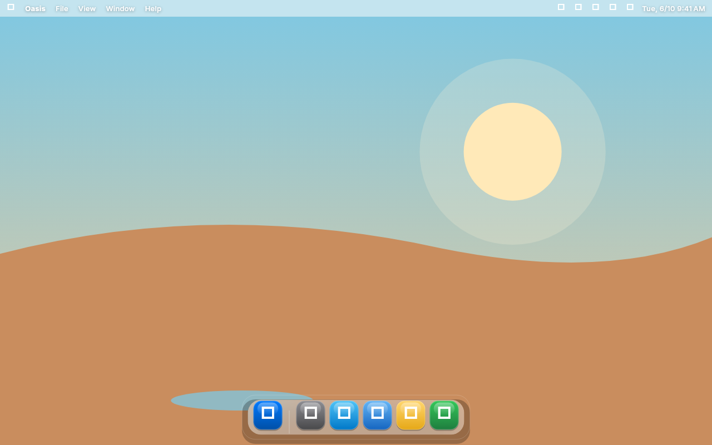
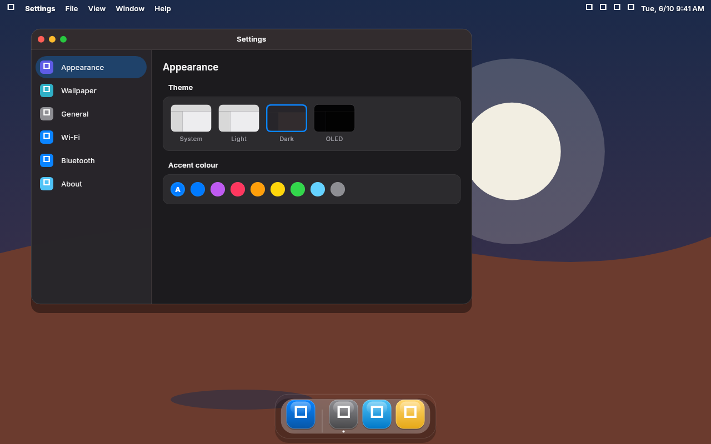
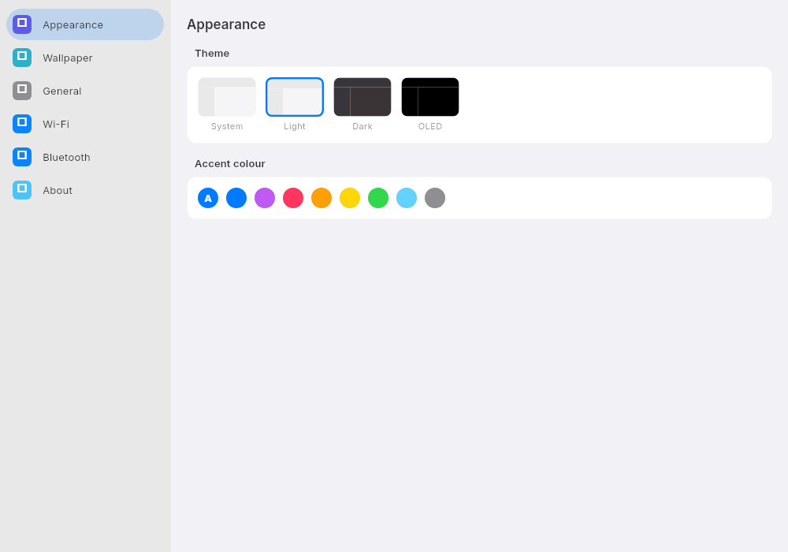

# Oasis

A calm, glassy desktop shell for Linux, built in Flutter.

Oasis is a desktop environment for people, not nerds. A floating dock, a translucent menu bar, a quiet launcher, a control center that stays out of your way. No terminal required, no ricing needed, nothing to configure before it feels right.



- **Dock** with magnification, running and pinned apps side by side
- **Menu bar** that belongs to whatever window is focused
- **Control center** for wifi, bluetooth, theme and sliders
- **Launcher** that filters as you type, keyboard-first
- **Settings** app with themes, accent colors, and language selection
- **Light, Dark and OLED** themes with a real glass material
- **In-app updates** checked against the releases below

| Dark | Settings |
|---|---|
|  |  |

## Download

Grab a build from [GitLab Releases](https://gitlab.com/HttpAnimations/oasis-de/-/releases). The landing page lives at [httpanimations.gitlab.io/oasis-de](https://httpanimations.gitlab.io/oasis-de/) and always links to the latest release.

On Fedora and other RPM distros, install the `.rpm` for your architecture. It registers an Oasis session so you can pick it from the login screen (SDDM, GDM).

### Web

The shell also runs as a normal app in your browser: [open it here](https://httpanimations.gitlab.io/oasis-de/app/).

## Building

Requires a stable Flutter SDK. The desktop shell targets Linux and web.

The Linux shell embeds a small Wayland compositor (`de/linux/runner/oasis_compositor.cc`), so native build deps are needed beyond the usual Flutter toolchain:

```sh
# Fedora / RHEL
sudo dnf install clang cmake ninja-build pkg-config gtk3-devel \
  wayland-devel wayland-protocols-devel libxkbcommon-devel \
  libdrm-devel mesa-libEGL-devel mesa-libGLES-devel

# Debian / Ubuntu
sudo apt-get install clang cmake ninja-build pkg-config libgtk-3-dev \
  liblzma-dev libwayland-dev wayland-protocols libwayland-bin \
  libxkbcommon-dev libdrm-dev libegl-dev libgles-dev
```

Then:

```sh
flutter pub get
(cd de && flutter run -d linux)
```

Tests, goldens and coverage run from the repo root:

```sh
flutter test --coverage
flutter test test/goldens_test.dart --update-goldens
```

## Writing apps for Oasis

Bundled apps live in `apps/` and are styled by the shared `oasis_ui` package, so anything built on it looks and behaves like a native part of the shell. Host services (theme, locale, updates, opening links) come from `OasisHost`. See [docs/apps.md](docs/apps.md) for the full contract.

## Architecture

Oasis is a nested compositor: the Flutter shell itself runs on GTK/Wayland and embeds a small wayland-server that hosts real Wayland clients inside shell windows. See [docs/architecture.md](docs/architecture.md) for the design and the protocol support matrix.

## Contributing

See [CONTRIBUTING.md](CONTRIBUTING.md).

## License

AGPL-3.0. See [LICENSE](LICENSE).
